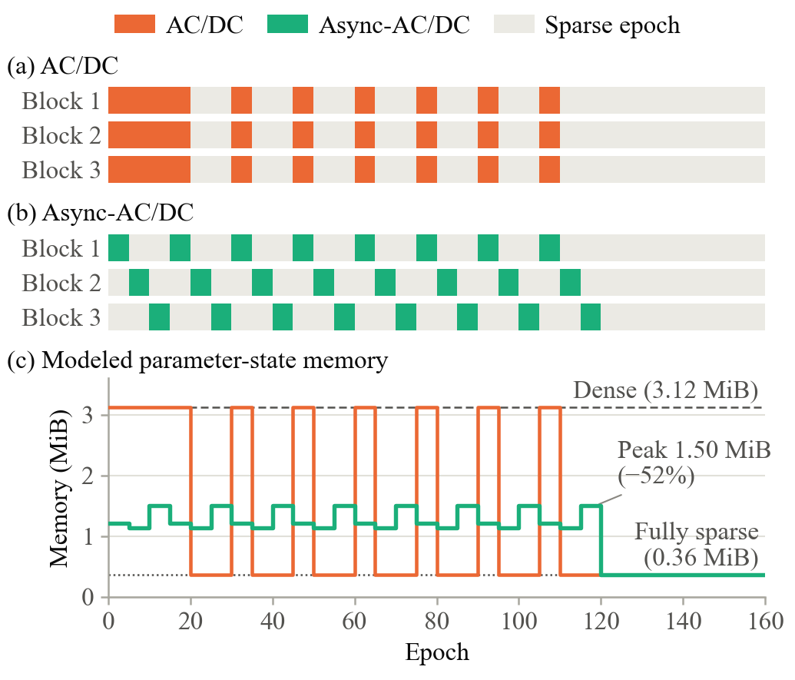
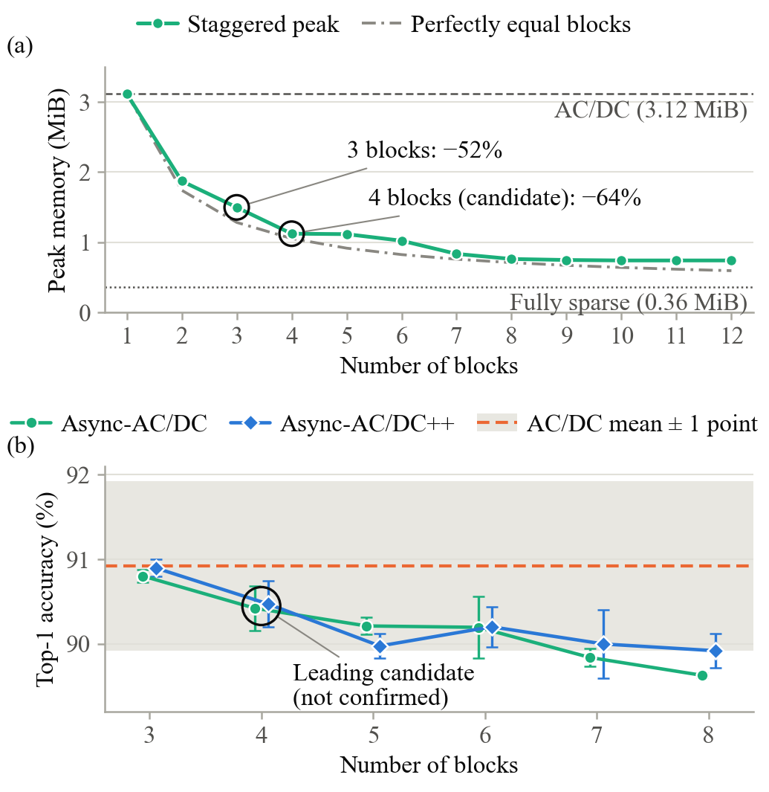

# Async-AC/DC: staggered dense phases for hybrid sparse training

Code, training notebook and per-run results for the research paper

> N. Mohammad, P. Ranchod and B. Ingram, *An Exploratory Study of Staggered Dense Phases for Lower Peak Memory in Hybrid Sparse Training*, School of Computer Science and Applied Mathematics, University of the Witwatersrand, 2026.

## What this is

[AC/DC](https://arxiv.org/abs/2106.12379) (Peste et al., NeurIPS 2021) trains a sparse network by switching **all** layers between a compressed (sparse) and a decompressed (dense) phase at the same time. Every dense phase therefore needs the dense weights, gradients and momentum of the whole network at once, so the peak memory of training is the same as for dense training.

**Async-AC/DC** splits the prunable layers into contiguous blocks and gives each block its own dense window, so that **at most one block is dense at a time**:

- the block boundaries come from an exact dynamic program that minimizes the size of the largest block;
- a nonoverlap condition on the schedule guarantees one dense block at a time;
- **Async-AC/DC++** adds a per-block learning-rate warm-up and a gradual (cubic) compression ramp.



## Main results

ResNet-20 on CIFAR-10 at 90% sparsity, 160 epochs, mean ± standard deviation over seeds 0, 1 and 2.

| Method | Top-1 accuracy (%) | Modeled peak parameter-state memory (MiB) |
|---|---|---|
| Dense | 92.74 ± 0.14 | 3.12 |
| AC/DC | 90.92 ± 0.23 | 3.12 |
| Async-AC/DC, 3 blocks | 90.80 ± 0.08 | 1.50 |
| Async-AC/DC++, 3 blocks | 90.90 ± 0.10 | 1.51 |
| SET (best always-sparse baseline) | 90.55 ± 0.14 | 0.36 |

The repository also contains GMP, SNIP, GraSP, RigL, Top-KAST and N:M baselines, a block-count sweep from 3 to 8 blocks and a ResNet-50 memory projection.



### Please read before reusing these numbers

- **The results are exploratory.** No validation split was held out, and the test set informed configuration choices, including the choice of four blocks as the leading candidate. The paper sets out a confirmatory protocol.
- **Memory figures are modeled.** They come from a byte-level model of sparse storage, whose accounting was checked against GPU allocations of the corresponding buffers. The training code itself stores dense tensors with binary masks, so actual GPU memory during training does not change between methods.
- **Comparisons with AC/DC change more than one factor.** Staggering also changes the dense-training budget (120 against 150 block-epochs) and the threshold scope (block-local against network-wide). The paper lists these confounds and the ablations that would separate them.

## Repository layout

| Path | Contents |
|---|---|
| `AsyncACDC_Implementation.ipynb` | Training code: data, ResNet-20, masking, the memory model, all methods, the schedules and the experiment runner |
| `make_thesis_figures.py` | Main tables and figures from the saved results |
| `analyze_blocks.py` | Block-count sweep: accuracy against the number of blocks |
| `reanalysis_revision.py` | Paired seed-level tests, Holm correction, repeated-measures and mixed-model analysis, the onset-aligned disturbance metric and the power calculation |
| `make_ieee_figures.py` | Column-width figures used in the paper |
| `results/*.json` | One file per training run (69 runs): configuration, final accuracy, accuracy and loss curves, memory trace and compression events |
| `results/*.csv` | Summary tables written by the scripts |
| `docs/` | Figures shown in this README |

## Installation

Python 3.9 or later.

```bash
pip install -r requirements.txt
```

Training needs a CUDA GPU. The analysis scripts run on a CPU in a few minutes.

## Reproducing the analysis (no GPU needed)

Every table, statistic and figure in the paper can be regenerated from the saved runs in `results/`:

```bash
python make_thesis_figures.py   # main comparison, memory, Pareto front, budgets
python analyze_blocks.py        # accuracy against the number of blocks
python reanalysis_revision.py   # paired tests, Holm, repeated measures, disturbance metric, power
python make_ieee_figures.py     # the four figures of the paper
```

Figures are written to `figures/` and tables to `results/`. On Windows with Anaconda, set `KMP_DUPLICATE_LIB_OK=TRUE` first, because Anaconda and PyTorch both ship an OpenMP runtime.

## Reproducing the training runs (GPU)

1. Open `AsyncACDC_Implementation.ipynb` in Jupyter or Google Colab. On Colab, the first cell mounts Google Drive so that finished runs survive a disconnect.
2. In the configuration cell, set `PRESET = "full"`, which gives 160 epochs with seeds 0, 1 and 2. The `smoke` and `fast` presets are short checks only.
3. Run all cells. CIFAR-10 downloads automatically into `./data`. Each run is saved as `results/<method>_<seed>_<hash>.json`, and an interrupted sweep resumes from the last finished run. One run took 35–56 minutes on a single GPU.

The block-count sweep uses the same runner with configuration overrides:

```python
for B in (4, 5, 6, 7, 8):
    for seed in (0, 1, 2):
        for method in ("async_acdc", "async_pp"):
            run_method(method, seed, n_blocks=B, acdc_cycle=max(15, 5 * B))

# eight blocks with a two-epoch dense phase
for seed in (0, 1, 2):
    for method in ("async_acdc", "async_pp"):
        run_method(method, seed, n_blocks=8, acdc_dense_len=2, acdc_cycle=16)
```

## Citation

```bibtex
@misc{mohammad2026asyncacdc,
  author       = {Mohammad, Nouran and Ranchod, Pravesh and Ingram, Branden},
  title        = {An Exploratory Study of Staggered Dense Phases for Lower Peak Memory in Hybrid Sparse Training},
  howpublished = {Research paper, School of Computer Science and Applied Mathematics, University of the Witwatersrand},
  year         = {2026},
  note         = {Code: \url{https://github.com/NouranMohammad/AsyncACDC}}
}
```

## License

MIT; see [LICENSE](LICENSE).

## Acknowledgment

The experiments were run on the high-performance computing cluster of the University of the Witwatersrand.
